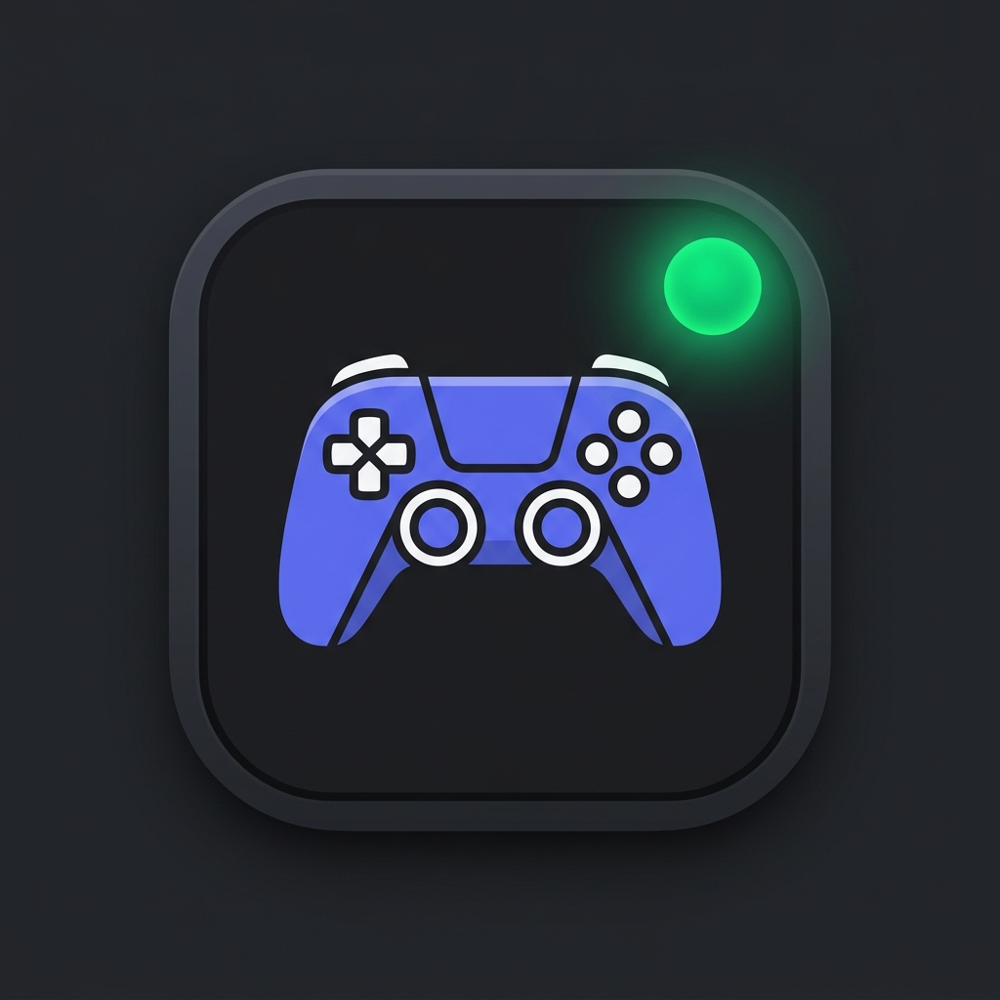

# 🎮 Discord Game Activity Manager

<p align="center">
  
</p>

<p align="center">
  <strong>Мощный десктопный менеджер игровой активности и квестов Discord нового поколения</strong><br>
  <em>A high-performance desktop Discord game activity and quest farming manager written in Rust.</em>
</p>

<p align="center">
  
  
  
  
  
  
</p>

---

[🇷🇺 Русский](#-на-русском) | [🇬🇧 English](#-in-english)

---

## 🇷🇺 На русском

### 🌟 О проекте

**Discord Game Activity Manager** — это легковесное, высокопроизводительное нативное приложение для Windows, предназначенное для:
1. **Прохождения заданий Discord Quests** (орбсы, аватары, рамки, нитро-награды) без необходимости скачивать тяжёлые игры по 50–150 ГБ.
2. **Прокачки значка игровой активности профиля Discord** через автоматическую ротацию игр из верифицированного каталога.

---

### 🚀 Ключевые особенности

- ⚡ **Двухуровневый гибридный движок (100% распознавание в Discord):**
  - **Discord Local IPC (`\\.\pipe\discord-ipc-0`):** Мгновенная прямая передача статуса `SET_ACTIVITY` через локальный сокет Discord с официальным `Client ID` игры. Discord сразу показывает статус *«Играет в ...»* с оригинальной иконкой и таймером.
  - **Process & Window Hooks (Stub Processes):** Для игр с квестами Discord запускаются микро-заглушки процессов с зарегистрированными в каталоге именами исполняемых файлов (`.exe`), перехватываемые сканером Discord.
- 📚 **Полная база из 24 970 игр Steam и Discord:**
  - База верифицирована и очищена от мусора, иероглифов и спецсимволов.
  - Удобный поиск с автоподбором по русским и английским синонимам (`COD`, `GTA`, `Dota`, `Варкрафт`, `Геншин` и др.).
- 🛡️ **Защита ПК и нулевая нагрузка:**
  - Процессы-заглушки потребляют **0% CPU** и **~1.5 МБ RAM**.
  - **Smart Protection:** программа автоматически сканирует запущенные на ПК процессы и исключает из ротации игры, в которые вы реально играете (CS2, Dota, Steam и т.д.).
- 🔄 **Бесшовное атомарное автообновление (Atomic In-Place Swap):**
  - Обновление исполняемого файла «на лету» без блокировок Windows (`ERROR_ACCESS_DENIED`).
  - Установка без всплывающих окон подтверждения UAC.
- 🌍 **Мультиязычность и масштабирование UI:**
  - Интерфейс на 3 языках: Русский, Українська, English.
  - 4 масштаба интерфейса (100%, 115%, 130%, 145%) на нативном шрифте Windows Segoe UI.

---

### 🕹️ Режимы работы

#### 1. Вкладка «Выполнение заданий»
- Позволяет выбрать любую игру из каталога через строку поиска.
- По нажатию кнопки **«Запустить на X мин»** игра активируется в Discord (процесс + IPC).
- По истечении выбранного времени активность автоматически снимается, а процесс завершается.

#### 2. Вкладка «Прокачка значка»
- Автоматический режим для прокачки статистики уникальных игр в профиле.
- Программа случайно выбирает пачку из `N` игр (рекомендуется 8) и запускает их параллельно.
- Таймер ротации автоматически сменяет пачки каждые 2, 15, 30, 60 или 120 минут.

#### 3. Вкладка «Настройки»
- Выбор языка интерфейса и масштаба шрифтов.
- Включение/отключение защиты запущенных на ПК игр.
- Проверка и установка обновлений в один клик.

---

### 📦 Установка

#### Способ 1: Установщик Windows (Рекомендуется)
1. Скачайте [DiscordGameFarmer_Setup.exe](https://github.com/dimalinau-lab/Discord-Game-Activity-Manager/releases/latest/download/DiscordGameFarmer_Setup.exe) со страницы [Релизов](https://github.com/dimalinau-lab/Discord-Game-Activity-Manager/releases).
2. Запустите файл установки (права администратора не требуются).
3. Программа установится в `%LOCALAPPDATA%\Programs\DiscordGameFarmer` и создаст ярлыки в меню «Пуск» и на Рабочем столе.

#### Способ 2: Портативная версия
- Скачайте `DiscordGameFarmer_v0.2.5_Portable.zip` из [Релизов](https://github.com/dimalinau-lab/Discord-Game-Activity-Manager/releases), распакуйте и запустите `discord-game-farmer.exe`.

---

### 🛠️ Сборка из исходников

Требования:
- Установленный компилятор [Rust](https://rustup.rs/) (версия 1.75+).
- ОС Windows 10/11 (x64).

```bash
# Клонировать репозиторий
git clone https://github.com/dimalinau-lab/Discord-Game-Activity-Manager.git
cd Discord-Game-Activity-Manager

# Сборка оптимизированного релиза
cargo build --release

# Бинарники появятся в target/release/
# - discord-game-farmer.exe
# - dummy_game.exe
```

---
---

## 🇬🇧 In English

### 🌟 Overview

**Discord Game Activity Manager** is an ultra-lightweight, high-performance native Windows desktop application engineered for:
1. **Completing Discord Quests** (Orbs, avatar decorations, profile frames, Nitro perks) without downloading 50–150 GB game clients.
2. **Discord Activity Badge Farming** by automatically rotating batches of verified games directly in your Discord profile.

---

### 🚀 Key Features

- ⚡ **Dual-Layer Hybrid Engine (100% Discord Recognition Guarantee):**
  - **Discord Local IPC (`\\.\pipe\discord-ipc-0`):** Sends `SET_ACTIVITY` frames directly over Discord's local pipe socket with official verified Application Client IDs. Shows *«Playing ...»* status with verified artwork and elapsed timer instantly.
  - **Process & Window Hooks (Stub Processes):** Spawns low-memory stub binaries matching registered Win32 `.exe` names required by Discord window/process scanner for Quest completion.
- 📚 **Catalog of 24,970 Verified Steam & Discord Titles:**
  - Fully normalized and sanitized database (zero CJK tofu or unrenderable glyphs).
  - Fast search with multi-word fuzzy matching and localized aliases (`COD`, `GTA`, `Warcraft`, `Genshin`, etc.).
- 🛡️ **PC Protection & Zero Resource Footprint:**
  - Stubs consume **0% CPU** and **~1.5 MB RAM**.
  - **Smart Protection:** Automatically scans running processes and ignores games currently played on your PC (e.g. CS2, Dota 2, Steam).
- 🔄 **Atomic In-Place Auto-Updater:**
  - In-place executable swap (`.exe` -> `.exe.old`), spawn & cleanup cycle avoiding Windows kernel file lock (`ERROR_ACCESS_DENIED`).
  - No administrator UAC prompts required.
- 🌍 **Internationalization & Responsive UI:**
  - 3 languages: Russian, Ukrainian, English.
  - 4 UI scale factors (100%, 115%, 130%, 145%) powered by native Windows Segoe UI typography.

---

### 🕹️ Operating Modes

#### 1. Quest Farming Tab
- Search for any Discord Quest title (e.g. Call of Duty, World of Warcraft, Once Human, Genshin Impact).
- Hit **«Launch for X min»** to run the game activity.
- The timer automatically clears presence and terminates processes once the session expires.

#### 2. Badge Farming Tab
- Automatic mode to increase the counter of unique games farmed on your Discord profile.
- Randomly selects `N` games (default: 8) and executes them in parallel.
- Automatically rotates batches every 2, 15, 30, 60, or 120 minutes.

#### 3. Settings Tab
- Language and UI scaling adjustments.
- Running PC game collision avoidance toggle.
- One-click update check and atomic upgrade.

---

### 📦 Installation

#### Method 1: Windows Installer (Recommended)
1. Download [DiscordGameFarmer_Setup.exe](https://github.com/dimalinau-lab/Discord-Game-Activity-Manager/releases/latest/download/DiscordGameFarmer_Setup.exe) from [Releases](https://github.com/dimalinau-lab/Discord-Game-Activity-Manager/releases).
2. Run the installer (standard user privileges, no UAC prompt).
3. Installs cleanly to `%LOCALAPPDATA%\Programs\DiscordGameFarmer` with Start Menu and Desktop shortcuts.

#### Method 2: Portable Mode
- Download `DiscordGameFarmer_v0.2.5_Portable.zip` from [Releases](https://github.com/dimalinau-lab/Discord-Game-Activity-Manager/releases), unpack and run `discord-game-farmer.exe`. Settings persist to adjacent `settings.json`.

---

### 🛠️ Building from Source

Prerequisites:
- [Rust toolchain](https://rustup.rs/) (stable 1.75+).
- Windows 10/11 (x64).

```bash
# Clone the repository
git clone https://github.com/dimalinau-lab/Discord-Game-Activity-Manager.git
cd Discord-Game-Activity-Manager

# Build optimized release binary
cargo build --release

# Binaries located at target/release/:
# - discord-game-farmer.exe
# - dummy_game.exe
```

---

### 📄 License

Distributed under the [MIT License](LICENSE).

